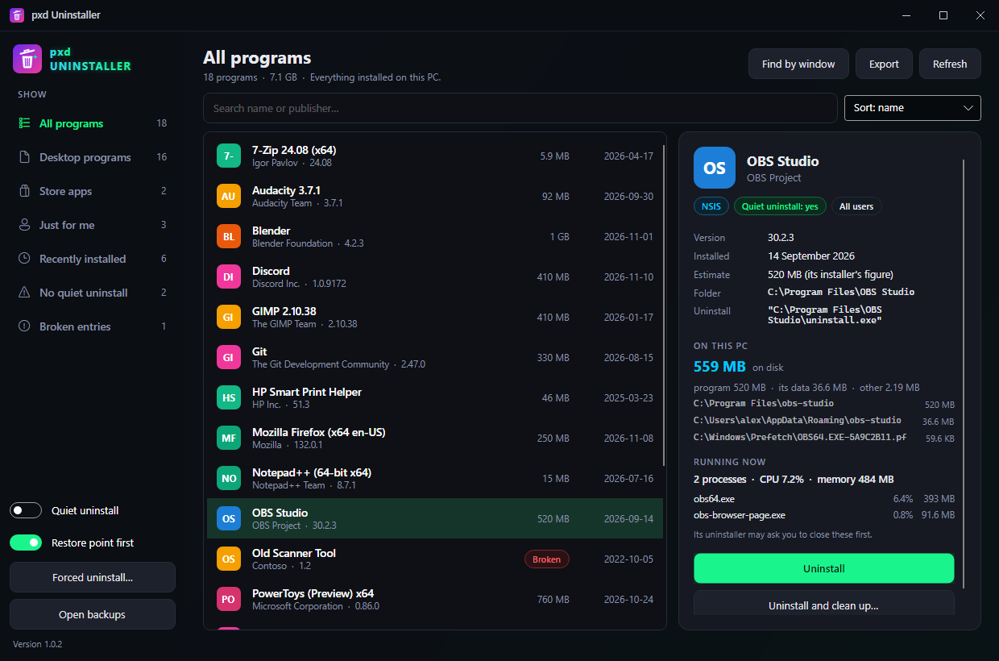
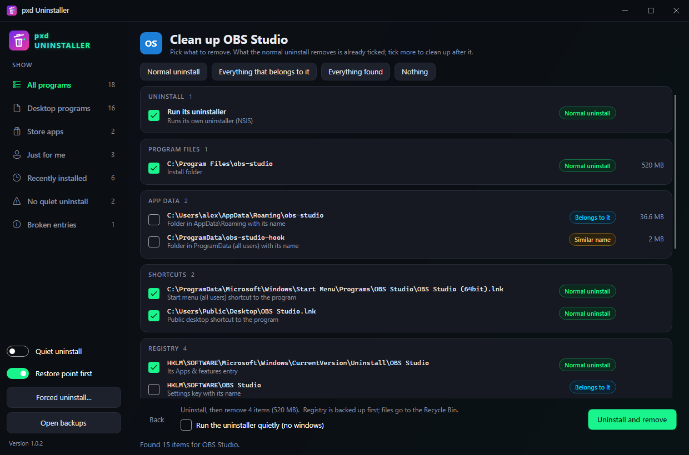
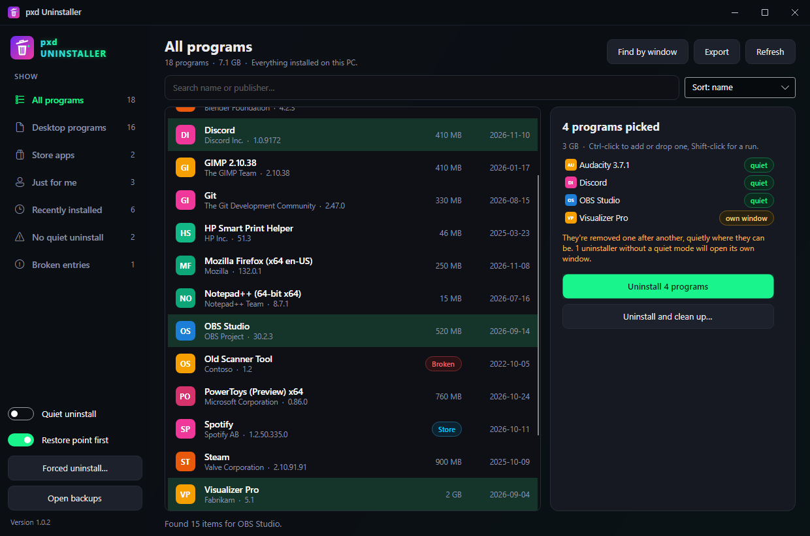
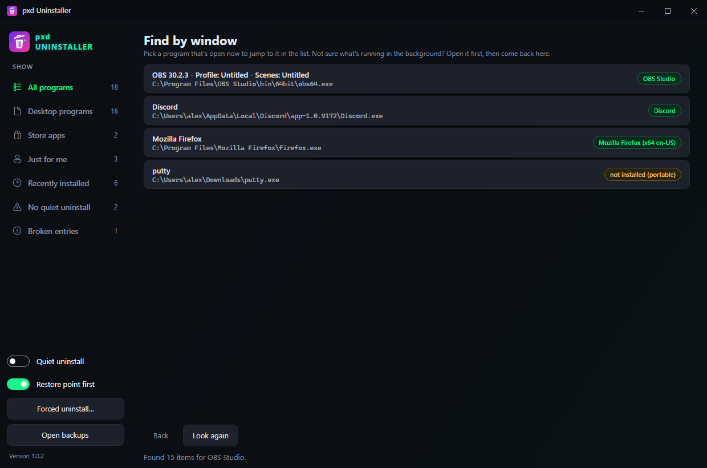
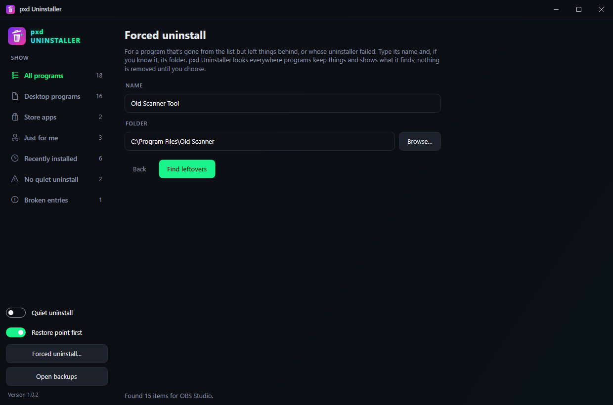

# pxd Uninstaller

Removes programs the normal way or all the way. Pick a program and press **Uninstall** to run its own uninstaller, or **Uninstall and clean up** to see everything that belongs to it first (its folders, registry keys, shortcuts, services, scheduled tasks, firewall rules and the traces Windows keeps) and choose what goes. From the command line, everything is removed quietly.

<p align="center">
  
</p>

## Features

- **Lists everything installed:** every Apps & features entry (all users, 64-bit and 32-bit, and just-for-you) plus your **Microsoft Store apps**, with icons, sizes and install dates. Windows updates, hidden system components and app frameworks are left out.
- **On this PC**, for the program you pick: the space it **really takes** (measured: its program folder, its data in AppData and ProgramData, and Windows' traces of it; not the installer's estimate), and its **services and processes running now** with their **CPU and memory**, updated every few seconds.
- **Uninstall** runs the program's own uninstaller, the normal way. Afterwards it offers to **look for leftovers**.
- **Uninstall and clean up** shows everything that belongs to the program before anything runs, grouped and with tick boxes:
  - **what the normal uninstall removes is ticked from the start** (its uninstaller, install folder, Apps & features entry, Start menu and desktop shortcuts),
  - everything else that **belongs to it** (folders in ProgramData, AppData, LocalLow and Temp, settings keys in the registry, Run entries, App Paths, services, scheduled tasks, firewall rules, file types and link handlers, COM components),
  - things with a **similar name** only, marked so you check them first,
  - and **Windows traces**: the cached program names, compatibility records, taskbar usage records, prefetch files, crash dumps and error reports.
- **Quick tick buttons:** normal uninstall only, everything that belongs to it, everything found, nothing.
- **Batch uninstall:** Ctrl- or Shift-click several programs and remove them one after another, quietly where they can be, then clean up all their leftovers on one page.
- **Forced uninstall:** clean up what's left of a program that's no longer listed (or whose uninstaller failed) by typing its name and picking its folder.
- **Find by window** (hunter): pick a program that's open now and jump straight to it in the list. A program that isn't installed (portable) goes to forced uninstall with its folder filled in.
- **Quiet uninstall** for Windows Installer (MSI), Inno Setup, NSIS, Squirrel, WiX bundles, Chromium, winget, Office Click-to-Run, OneDrive, Visual Studio and Store apps, plus any program that gives its own quiet command. The details say when a program can't run quietly, and why.
- **Broken entries:** programs whose uninstaller is gone are grouped, and their leftovers can still be cleaned up.
- **Safe:** a **restore point** first (on by default), every registry key and value saved to a `.reg` file before it's removed (double-click it to put them back), files sent to the **Recycle Bin**, and Windows, system and profile folders never offered. Anything another installed program uses (its folder, uninstaller or icon) is left alone.
- **Export** the list as a web page or a CSV spreadsheet.
- **pxd standard:** dark pxd title bar, remembers its window, one copy at a time, installed and kept up to date by **[pxd Toolkit](https://github.com/pxdtek/pxdToolkit)**.

| Clean up | Batch uninstall |
| --- | --- |
|  |  |
| **Find by window** | **Forced uninstall** |
|  |  |

## Command line

`pxdu.exe` sits next to the app (and `pxdUninstaller.exe` takes the same commands). Everything it removes is removed **quietly**: a program whose uninstaller has no quiet mode is never started; it's skipped and reported (exit code 3).

```powershell
pxdu list                          # programs and Store apps (add text to filter, --json for scripts)
pxdu list --html programs.html     # or --csv programs.csv
pxdu show "7-Zip"                  # details, how it uninstalls, space on disk, what's running
pxdu which steam                   # which installed program a running program belongs to
pxdu leftovers "7-Zip" [--all]     # what a deep uninstall would remove; changes nothing
pxdu remove "7-Zip" "VLC media player"          # quiet uninstall
pxdu remove "7-Zip" --deep                       # plus everything that belongs to it
pxdu remove "7-Zip" --deep-all --dry-run         # plus similar names; only show what would happen
pxdu forced "Old Tool" --folder "C:\Program Files\Old Tool"   # leftovers of a program that's gone
```

Other options for `remove` and `forced`: `--restore-point` (make one first), `--permanent` (delete files instead of using the Recycle Bin). A program is a name, a unique part of one, or an id from `list --json`. Programs installed for all users need an elevated prompt (exit code 5). Exit codes: 0 done, 2 not found or ambiguous, 3 can't be removed quietly, 4 something couldn't be removed, 5 administrator rights needed.

## Supported systems

| System | Status | Notes |
| --- | --- | --- |
| Windows 11, x64 | **Tested** | |
| Windows 10, x64 | Should work, untested | Same uninstall registry and Store APIs. |
| Windows Server 2016 and later | Should work, untested | No Store apps. |

## Install

- **With [pxd Toolkit](https://github.com/pxdtek/pxdToolkit)** (recommended): pick pxd Uninstaller and press Install. The Toolkit keeps it up to date.
- **With winget:** `winget install pxdtek.Uninstaller`
- **By hand:** download `pxdUninstaller-<version>-win-x64.zip` from [Releases](https://github.com/pxdtek/pxdUninstaller/releases), unzip it anywhere and run `pxdUninstaller.exe`. It needs the [.NET 10 Runtime](https://dotnet.microsoft.com/download/dotnet/10.0).

The app asks for administrator rights when it opens (most uninstallers need them). Say no and it still runs, but can only remove programs installed just for you. Each time it starts, it checks for a newer release (at pxdtek.com, or GitHub when pxdtek.com can't be reached) and installs it into its own folder before opening; it just opens when offline. Set `PXD_NO_UPDATE=1` to turn that off.

Settings are kept in `%APPDATA%\pxdUninstaller`, backups in `%APPDATA%\pxdUninstaller\Backups` (one folder per uninstall, with `registry.reg` and a list of what was removed).

## How leftovers are found

pxd Uninstaller notes the program's folders and files **before** it runs the uninstaller, then looks in every place programs keep things. Something **belongs to it** when it points into the program's folder (shortcuts, Run entries, services, tasks, firewall rules, file types, COM components, Windows' records) or carries its exact name (or its install folder's name), also under the publisher's folder or key. A **similar name** is a name that starts the same way. Folders that hold or sit inside another installed program, and every Windows, system and profile folder, are never offered.

## Build

```powershell
dotnet build -c Release
dotnet build cli\pxdu.csproj -c Release
# the exe's icon (optional; a fresh clone builds without it)
bin\Release\net10.0-windows\pxdUninstaller.exe --write-icon Assets\pxdUninstaller.ico
```

Checks: `pxdUninstaller.exe --self-test <folder>` tests the command-line and path readers and installer-type detection, lists this PC's programs and finds the leftovers of a few (read only), then installs made-up programs into a sandbox (registry under `HKCU\Software\pxdUninstallerSelfTest`, folders inside the test folder) and uninstalls them for real: quiet uninstall, every kind of leftover, backups and restoring them, forced uninstall, hunter, export and the command line. It renders the window to PNGs off-screen (nothing appears on screen). Add `--sample` for the made-up programs used in the screenshots.
